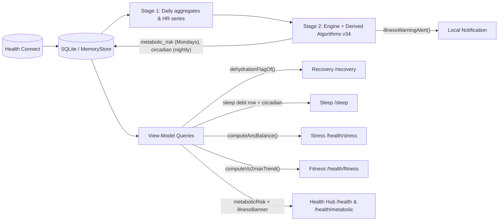

# Derived Health Insights & Early-Warning Alerts

Health derives seven higher-order health tracking insights and alerts on top of the imported Health Connect data and core physiological engine. Two algorithms (**Metabolic Risk Score** and **Circadian Rhythm Score**) run in the deterministic Stage 2 pipeline (`SCORING_VERSION = 34` in `src/pipeline/types.ts`), four are computed purely in the query layer without requiring storage changes, and one adds rising-edge early-warning notifications and UI visibility for elevated illness signals.

## Architecture & Data Flow

## Summary Matrix

| # | Feature | Layer | Where it appears | Core implementation |
|---|---|---|---|---|
| 1 | **Metabolic Risk Score** | Stage 2 pipeline (`metabolic_risk`) | Health Hub card & `/health/metabolic` | `src/core/algorithms/metabolicRisk.ts`, `src/queries/health.ts` (`getMetabolicRisk`), `src/screens/health/MetabolicScreen.tsx` |
| 2 | **Circadian Rhythm Score** | Stage 2 pipeline (`circadian`) | Sleep detail screen (`CircadianCard`) | `src/core/algorithms/circadian.ts`, `src/pipeline/stage2.ts` (`findHrNadirOffsetH`), `src/screens/sleep/SleepCards.tsx` |
| 3 | **ANS Balance Index** | Query layer | Stress Monitor (`AnsBalanceCard`) | `src/queries/health.ts` (`computeAnsBalance`), `src/screens/health/StressScreen.tsx` |
| 4 | **Aerobic Base Trend** | Query layer | Fitness (`AerobicBaseCard`) | `src/queries/health.ts` (`computeVo2maxTrend`), `src/screens/health/FitnessScreen.tsx` |
| 5 | **Sleep Debt Accumulator** | Query + UI summary | Sleep summary rows (`SleepScreen`) | `src/queries/sleep.ts` (`getSleep`), `src/screens/sleep/SleepScreen.tsx` |
| 6 | **Illness Risk Early Warning** | Background alerts + Health Hub | Notification & Health Hub Monitor banner | `src/background/smart.ts` (`illnessWarningAlert`), `src/queries/health.ts` (`getHealthHub`), `src/screens/health/HealthScreen.tsx` |
| 7 | **Dehydration / Recovery Flag** | Query layer | Recovery screen `InsightCard` -> `/log?kind=water` | `src/queries/recovery.ts` (`dehydrationFlagOf`), `src/screens/recovery/RecoveryScreen.tsx` |

---

## 1. Metabolic Risk Score

- **Goal:** Track long-term cardiometabolic resilience vs. stress load using five physiological markers over a 60-day rolling baseline.
- **Cadence:** Published every **Monday** (and carried forward through the week alongside Healthspan updates).
- **Minimum calibration:** `METABOLIC_MIN_DAYS = 21` days with RHR or HRV data. Days before calibration or without usable signals return `null` (honest calibrating/no-data state).
- **Algorithm (`src/core/algorithms/metabolicRisk.ts`):**
  - Z-scores five signals strictly against causal prior baselines (days strictly before the scored day via `foldHistory`):
    - Resting heart rate (`rhr`): `+0.30` (higher is adverse)
    - Nightly HRV (`hrv`): `-0.30` (lower is adverse)
    - Sleep Performance (`sleepPct`): `-0.20` (lower is adverse)
    - Daily steps (`steps`): `-0.10` (lower is adverse)
    - Respiratory rate (`resp`): `+0.10` (higher is adverse)
  - Missing signals are dropped and weights renormalize over available signals.
  - Converts weighted z-score $R$ via logistic transform: `round(100 / (1 + exp(-1.5 * R)))`.
  - **Bands:** `low` (`< 40`), `moderate` (`40–59`), `elevated` (`60–74`), `high` (`>= 75`).
  - Tracks up to the top 3 contributing signals sorted by impact (`topContributors`).
- **UI:** Summary card on Health Hub (`/health`) and dedicated detail screen `/health/metabolic` (`MetabolicScreen.tsx`, `app/health/metabolic.tsx`) with 0–100 `TickScale`, driver insight, 6M Monday trend chart, and 30-day contributor breakdown rows.

## 2. Circadian Rhythm Score

- **Goal:** Quantify sleep-wake schedule regularity, phase shifts, and nocturnal temperature/heart-rate nadir alignment.
- **Minimum calibration:** 7 nights with sleep onset timestamps in the current 7-night window (uses up to 14 nights for prior-week phase-shift comparison).
- **Algorithm (`src/core/algorithms/circadian.ts`):**
  - **Consistency ($S_1$):** Circular resultant length $R \in [0, 1]$ across sleep onset timestamps modulo 24 hours (`S1 = clamp(R * 100, 0, 100)`).
  - **Phase classification:**
    - `irregular` when $R < 0.7$.
    - Otherwise compares circular mean onset vs. the prior 7 nights: `shifted_late` (`delta > +30 min`), `shifted_early` (`delta < -30 min`), or `aligned` (within `±30 min`).
  - **Temperature nadir alignment ($S_2$, optional):** Evaluates nightly skin temperature nadir offset relative to sleep onset (`tempNadirOffsetH`, extracted in `src/pipeline/stage2.ts`), scored against an ideal `2.5 h` offset: `max(0, 1 - |offset - 2.5| / 3) * 100`.
  - **HR–temperature nadir coupling ($S_3$, optional):** Evaluates alignment between sleeping heart-rate nadir (`hrNadirOffsetH`, computed in `src/pipeline/stage2.ts` via `findHrNadirOffsetH`) and skin temperature nadir: `max(0, 1 - |hrOffset - tempOffset| / 1.5) * 100`.
  - **Combining weights:** `0.5 * S1 + 0.3 * S2 + 0.2 * S3` (renormalized when temperature or HR nadir data are absent: `S1` alone if no temp nadir; `(0.5 * S1 + 0.3 * S2) / 0.8` if no HR/temp pair).
- **UI:** Rendered as `CircadianCard` inside `/sleep` (`src/screens/sleep/SleepCards.tsx`), showing score, phase `StatusChip`, component breakdown (Onset Consistency, Temp Alignment, Nadir Coupling), and sleep onset / midpoint / HR nadir times.

## 3. ANS Balance Index

- **Goal:** Combine daytime autonomic arousal and overnight parasympathetic recovery into a single 0–100 index (`50 = balanced`).
- **Algorithm (`computeAnsBalance` in `src/queries/health.ts`):**
  - **$A$ (Daytime calm fraction, 40%):** `(1 - sympatheticFraction) * 100`, where `sympatheticFraction` is the fraction of non-sleep minute stress samples above `40` (falling back to `highMin / totalMin` when intraday series is unavailable).
  - **$B$ (Overnight HRV vs. 30-day baseline, 40%):** `clamp(50 + 15 * zHrv, 0, 100)` using 30-day prior HRV mean and SD (with `illnessSdFloor.hrv` floor). Defaults to `50` when overnight HRV is unavailable.
  - **$C$ (7-day HRV Status adjustment, 20%):** `unbalanced_high = 70`, `balanced = 50`, `unbalanced_low = 30`, `low = 15`, `null = 50`.
  - **Score & bands:** `round(clamp(0.4 * A + 0.4 * B + 0.2 * C, 0, 100))`; `parasympathetic` (`>= 65`), `balanced` (`40–64`), `sympathetic` (`< 40`).
- **UI:** `AnsBalanceCard` on `/health/stress` (`src/screens/health/StressScreen.tsx`) with `TickScale` meter (`0–100`) and input summary.

## 4. Aerobic Base Trend

- **Goal:** Detect whether cardiorespiratory fitness (VO2 max) is actively building, plateauing, or detraining over a trailing 4-week window.
- **Algorithm (`computeVo2maxTrend` in `src/queries/health.ts`):**
  - Collects available VO2 max values over the last 28 days (requires at least `7` observations).
  - Fits an exponentially weighted ordinary least-squares slope with recency weights `w_i = 0.95^(28 - dayIndex)`.
  - Projects slope to 28-day delta (`slope * 28` in `mL/kg/min over 4 weeks`).
  - **Direction:** `improving` (`> +2`), `stable` (`[-2, +2]`), `detraining` (`< -2`).
- **UI:** `AerobicBaseCard` on `/health/fitness` (`src/screens/health/FitnessScreen.tsx`), placed directly below the VO2 max hero with direction chip, 4-week delta, and observation count.

## 5. Sleep Debt Accumulator Surfacing

- **Goal:** Make cumulative 7-day sleep debt immediately actionable alongside Hours vs. Needed on `/sleep` without needing to dig into secondary cards or settings.
- **Implementation (`src/queries/sleep.ts` & `src/screens/sleep/SleepScreen.tsx`):**
  - Promoted `debt` into the primary `summary` array right after `hours` (`hours | debt | consistency | efficiency | restorative | sleepStress`), deep-linking to `/chart?metric=debt&r=w`.
  - Displays a warning `StatusChip` whenever `debt > 60` minutes.

## 6. Illness Risk Early Warning

- **Goal:** Surface multi-signal physiological deviations promptly in both background notifications and the Health Hub.
- **Notification trigger (`illnessWarningAlert` in `src/background/smart.ts` & `src/background/alerts.ts`):**
  - Fires on the **rising edge** when today's `health_monitor.illness.level === "raised"` while yesterday's level was not `"raised"`.
  - Gated on `settings.healthMonitor` and `source === "health_connect"` (sample mode never notifies).
  - Deduplicated once per local day via `markers.illnessWarningDay` (`src/background/decide.ts`) and fixed notification identifier `illness_warning_<today>`.
  - Names the specific `firedSignals` in the notification body and deep-links to `health://health/monitor`.
- **Health Hub visibility (`src/queries/health.ts` & `src/screens/health/HealthScreen.tsx`):**
  - Surfaces an alert banner inside the Health Monitor hub card whenever `hm.illness` is elevated (`raised` or corroborated `alreadyUnwell`), listing active fired signals.

## 7. Dehydration / Recovery Quality Flag

- **Goal:** Catch an elevated resting heart rate paired with suppressed HRV that cannot be explained by yesterday's strain, active illness, or poor sleep, nudging the owner to check hydration.
- **Algorithm (`dehydrationFlagOf` in `src/queries/recovery.ts`):**
  - Uses 30-day prior baselines (minimum `14` prior observations) with SD floors (`1.25 bpm` for RHR, `0.05` for `ln(hrvMs)`).
  - Flags only when all conditions hold simultaneously:
    - `zRhr > +1.5`
    - `zHrv < -1.5`
    - `yesterdayStrain < 60`
    - `illness.level !== "raised"`
    - `sleepPerformance > 60%`
- **UI:** Renders a warning-toned `InsightCard` on `/recovery` (`src/screens/recovery/RecoveryScreen.tsx`) with a quick link directly to `/log?kind=water`.

