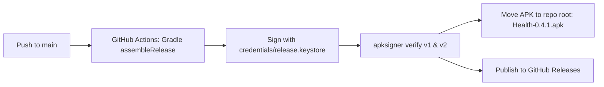
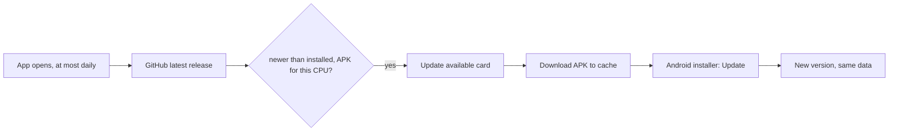

# Releasing APKs

Health builds and signs production release APKs automatically through GitHub Actions (`.github/workflows/build-apk.yml`) on every push to `main`.

## Automated CI/CD Workflow

1. **Continuous Native Generation**: `expo prebuild --clean` runs in CI and applies `plugins/withReleaseSigning.js` to configure release signing configs.
2. **Release Signing & Play Integrity**: The APK is compiled as a release variant (`android:debuggable="false"`) and signed with `credentials/release.keystore` (PKCS#12, RSA 2048, validity 28 years). This satisfies Play Protect and Play Integrity without debug flags.
3. **Repository Placement**: The workflow automatically commits `Health-0.4.1.apk` directly to the root of the repository so you can download it directly from the repo files.
4. **GitHub Releases**: The APK is attached to GitHub Release `v0.4.1` on the repository homepage for a 1-click download.

## In-App Updates

Once a day, as the app opens or comes back to the front, Health checks GitHub's latest-release endpoint (`src/state/update.ts`). When a newer release is published, the app notifies the user and downloads the updated APK directly to install over the existing app. Because all builds are signed with the same `credentials/release.keystore`, Android updates smoothly without uninstalling.

